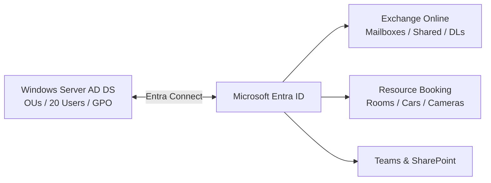

# ☁️ Enterprise Hybrid Cloud Identity & M365 Home Lab

> **TL;DR (Quick Summary):** Built a simulated enterprise IT environment integrating cloud-hosted **Windows Server Active Directory** with **Microsoft Entra ID** and **Microsoft 365** via **Entra Connect**. Practiced end-to-end user lifecycle management, Group Policy (GPO), Exchange resource scheduling, and Helpdesk troubleshooting.

## 🏗️ Architecture Overview

## 🛠️ Key Hands-On Lab Highlights
* **Active Directory & Hybrid Sync:** Structured departmental OUs (Finance, Admin, Sales) for 20 virtual users, deployed desktop wallpaper **GPOs**, and configured **Entra Connect** synchronization.
* **Exchange Online Administration:** Managed M365 licenses, departmental **Shared Mailboxes**, and company-wide/departmental **Distribution Lists**.
* **Resource & Asset Scheduling:** Configured self-service **Room Mailboxes** and **Equipment Mailboxes** (company vehicles & DSLR cameras) to prevent booking conflicts.
* **Collaboration Portals:** Set up a company **SharePoint Intranet** homepage and departmental **Microsoft Teams** workspaces.

## 📂 Featured Documentation (Click to View)
* 📖 **[End-User SOP: Booking Company Vehicles & DSLR Cameras via Outlook](./docs/sop-device-booking.md)**
* 🔧 **[Troubleshooting KB: Resolving Local AD to M365 User Sync Failures](./docs/troubleshooting-entra-sync.md)**

