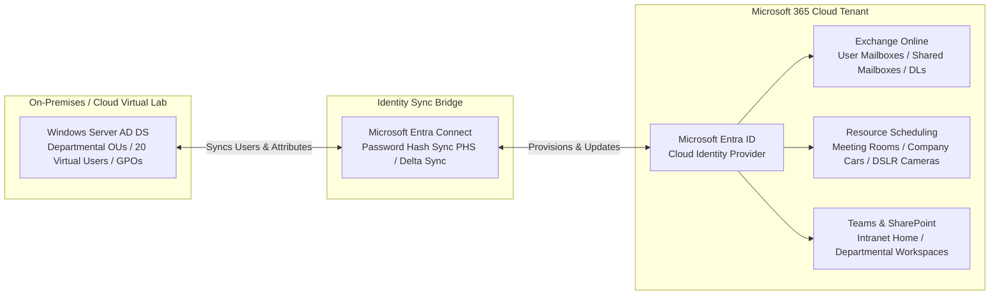

# ☁️ Enterprise Hybrid Cloud Identity & Microsoft 365 Administration Home Lab

## 📌 Project Overview
This project simulates a modern small-to-medium enterprise (SME) IT infrastructure and daily Helpdesk support environment. Built on a cloud-hosted **Windows Server Active Directory** integrated with **Microsoft Entra ID (formerly Azure AD)** and **Microsoft 365**, this lab demonstrates hands-on capabilities in **hybrid identity synchronization, Group Policy management, Exchange Online administration, resource scheduling, and enterprise collaboration portals**.

## 🏗️ Hybrid System Architecture

## 🛠️ Core IT Helpdesk & Administration Skills Demonstrated

### 1. Identity & Access Management (IAM & Active Directory)
* **Organizational Unit (OU) Design**: Structured a realistic corporate hierarchy in local AD (Finance, Admin, Sales, etc.) and provisioned 20 simulated employee accounts across departments.
* **Hybrid Identity Synchronization**: Deployed and configured **Microsoft Entra Connect** to automate user provisioning and attribute synchronization between local AD and cloud Entra ID.
* **Group Policy Management (GPO)**: Created and enforced standardized desktop wallpaper policies across domain-joined endpoints.

### 2. Exchange Online & Resource Scheduling
* **License & Mailbox Provisioning**: Assigned Microsoft 365 licenses and configured corporate email accounts for all 20 virtual employees.
* **Shared Mailboxes**: Configured departmental shared mailboxes (Finance, Admin, Sales) to enable collaborative email handling without sharing individual credentials.
* **Distribution Lists (DLs)**: Created company-wide announcement groups and department-specific distribution lists to streamline internal communications.
* **Room & Equipment Mailboxes**:
  * Configured self-service **Room Mailboxes** for conference room bookings.
  * Configured **Equipment Mailboxes** for high-value company assets (company vehicles and DSLR cameras), enabling conflict-free calendar scheduling via Outlook.

### 3. Enterprise Collaboration (Microsoft Teams & SharePoint)
* Built a centralized **SharePoint Online Intranet Home** for company announcements and documentation.
* Deployed dedicated **Microsoft Teams** workspaces for each department to support daily communication and file sharing.

## 📂 Standard Operating Procedures (SOPs) & Troubleshooting Logs
* 📖 **[End-User SOP: How to Book Company Vehicles & DSLR Cameras via Outlook](./docs/sop-device-booking.md)** — *Demonstrates clear, jargon-free documentation for non-technical end users.*
* 🔧 **[Troubleshooting KB: Newly Created AD User Not Syncing to Microsoft 365](./docs/troubleshooting-entra-sync.md)** — *Demonstrates structured root-cause analysis in a hybrid cloud environment.*

---
*Disclaimer: This lab was built using a Microsoft Azure trial environment. All domains, public IPs, and user credentials referenced in this repository have been sanitized for security.*

